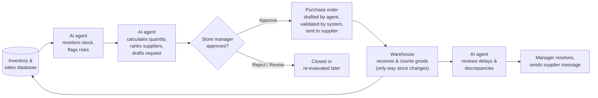
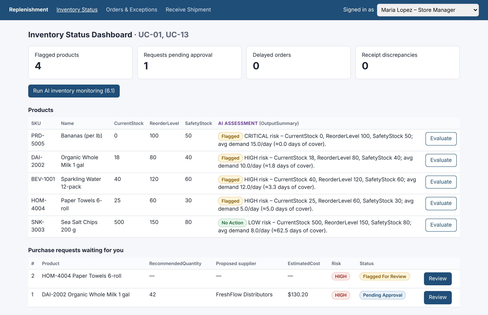
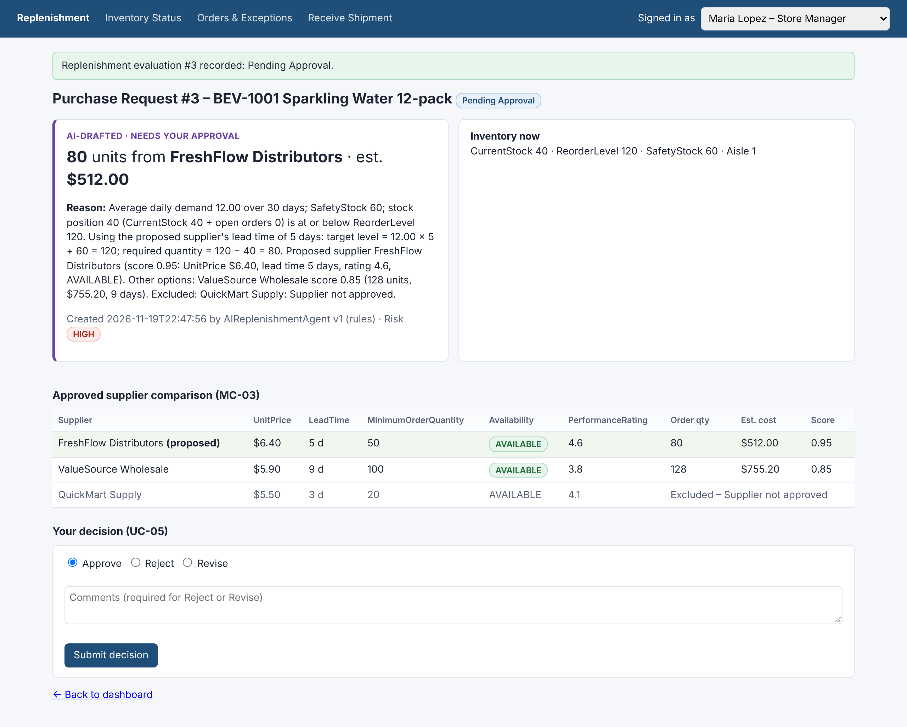
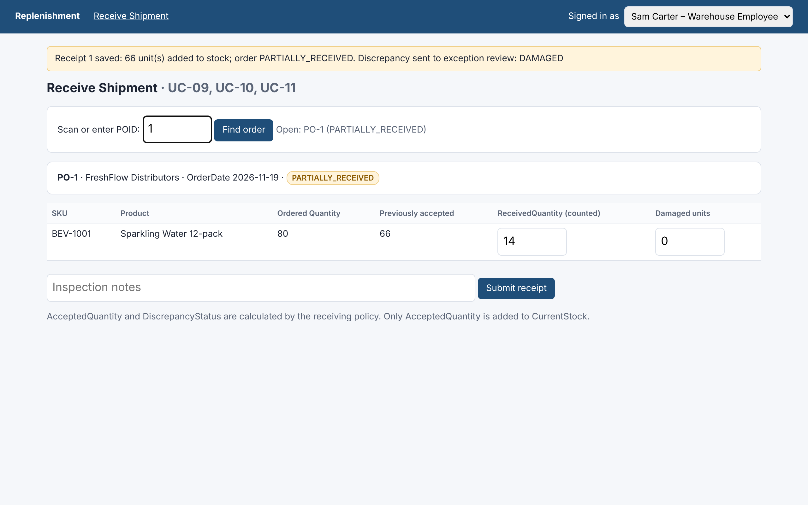
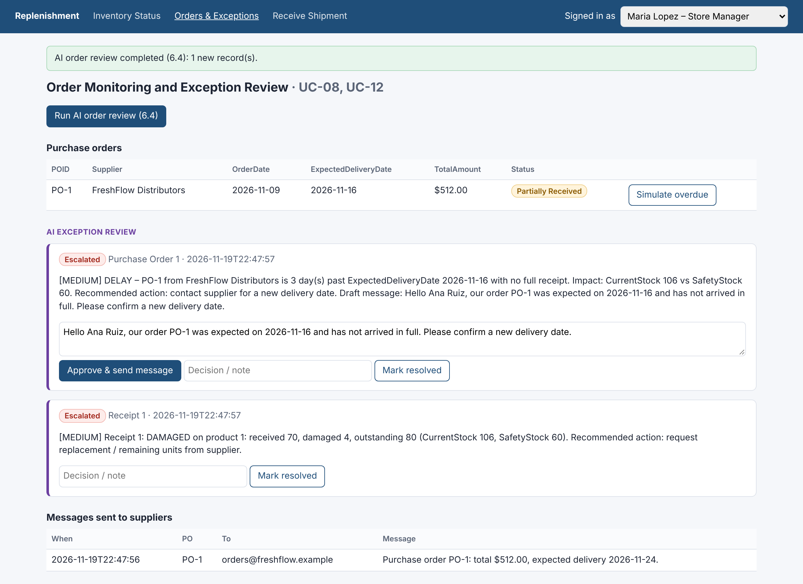

# Agentic AI Inventory Replenishment

Retail store managers spend hours checking stock levels, working out how much to reorder, comparing suppliers and drafting purchase orders. This project is an **AI agent that does that analysis for them**. It monitors inventory, decides what to reorder and from which supplier, drafts the purchase order, and flags late or damaged deliveries. **A human approves every order** before anything is sent.


## What it does

- **Spots stock risks.** Checks each product's stock against its reorder level and safety stock, estimates days of cover from 30 days of sales, and rates the risk (Critical / High / Medium / Low).
- **Works out what to order.** Calculates the quantity needed to cover demand until the supplier can deliver, counting stock already on order so nothing is ordered twice.
- **Picks the best supplier.** Removes unapproved or unavailable suppliers and ones whose minimum order is too large, then scores the rest on price, delivery time, reliability and availability.
- **Explains every recommendation.** Each proposal shows the full calculation and why other suppliers lost or were excluded.
- **Keeps a human in charge.** The manager approves, rejects or sends back each request. The agent only drafts; the system re-checks the approved order before sending it.
- **Handles problems after ordering.** Detects late deliveries and shortages, overages or damaged goods, sets a priority, and drafts a follow-up message to the supplier for the manager to send.

## How it works



**Guardrails built into the system, not just the agent:**

| The agent can… | The agent cannot… |
|---|---|
| Analyse stock, sales and supplier data | Approve a purchase |
| Draft purchase requests and orders | Send an order or message to a supplier |
| Flag and prioritise problems | Change stock levels |
| Escalate missing or uncertain data | Guess when data is missing |

Each rule is enforced by role checks, by the database, or by the order-validation step, and each one has an automated test. Every agent decision is saved with a timestamp for audit.

**About the agent:** the decision logic is rule-based. It uses a replenishment formula, weighted supplier scoring and severity rules rather than a language model, so every recommendation is explainable and repeatable. The agent class (`app/agent.py`) is the plug-in point for an LLM, for example to write summaries or supplier emails, while the guardrails stay in the system.

## Screenshots

| Inventory dashboard | AI-drafted purchase request |
|---|---|
|  |  |
| **Receiving a delivery** | **Exception review** |
|  |  |

## Tech stack

Python · Flask · SQLite · pytest · Playwright (screenshots)

- **36 automated tests**, covering the calculations, supplier ranking, approval rules, order validation, receiving transactions and the agent's guardrails, plus an end-to-end test through the web screens.
- **Transactional receiving.** A receipt either updates everything (stock, order status, discrepancies) or nothing.
- **Database-level business rules.** CHECK, UNIQUE and foreign-key constraints, for example a request awaiting approval must have a supplier, quantity and cost.

## Requirements
- Python 3.10 or newer (check with `python3 --version`)
- Git

## Run it (first time)

**1. Download the project**
```bash
git clone https://github.com/TanviMehta2495/agentic-ai-inventory-replenishment.git
cd agentic-ai-inventory-replenishment
```

**2. Create and turn on a virtual environment**

macOS / Linux:
```bash
python3 -m venv .venv
source .venv/bin/activate
```
Windows (PowerShell):
```powershell
py -m venv .venv
.venv\Scripts\Activate.ps1
```
Your prompt should now start with `(.venv)`.

**3. Install the packages**
```bash
pip install -r requirements.txt
```

**4. Start the app**
```bash
python -m app.web
```
Open **http://127.0.0.1:5001** in your browser. Press `Ctrl + C` in the terminal to stop it.

The app creates `replenishment.db` with sample data on first start. Delete that file to reset the data.

## Run it again later
```bash
cd agentic-ai-inventory-replenishment
source .venv/bin/activate        # Windows: .venv\Scripts\Activate.ps1
python -m app.web
```

## Run the tests
```bash
python -m pytest -v tests        # 36 tests, each traced to a requirement / design element
```

## Troubleshooting
| Problem | Fix |
|---|---|
| `command not found: python` or `pip` | Turn on the virtual environment (step 2), or use `python3` / `python3 -m pip` |
| `externally-managed-environment` | You skipped step 2; create and turn on the virtual environment first |
| `No module named flask` | Run step 3 with the virtual environment turned on |
| `source: no such file or directory: .venv/bin/activate` | You are in the wrong folder, or the environment was not created there; `cd` into the project and repeat step 2 |
| Port already in use | Start on another port: `PORT=5002 python -m app.web` |

## Try it yourself (≈3 minutes)
1. **Inventory Status** → *Run AI inventory monitoring*: 4 products are flagged, 1 needs no action.
2. Click *Evaluate* on **Organic Whole Milk**. The agent drafts a request for 42 units from FreshFlow, shows the calculation, and explains why ValueSource was excluded (minimum order 600 units).
3. Click *Evaluate* on **Paper Towels**. It's *Flagged for Review*: the only supplier is unavailable, so the agent escalates instead of guessing.
4. On a pending request, choose *Reject* with no comment: it's blocked. Then *Approve*: the order is validated and sent to the supplier.
5. Switch the user (top right) to **Sam Carter – Warehouse Employee** → *Receive Shipment* → enter fewer units than ordered and a few damaged. Only good units are added to stock, and the problem is escalated.
6. Switch back to **Maria Lopez – Store Manager** → **Orders & Exceptions** → *Simulate overdue* → *Run AI order review*. The delay is escalated with a draft supplier message for you to send or resolve.

## Code map
| Path | What's there |
|---|---|
| `app/agent.py` | The AI agent: monitoring, replenishment evaluation, order drafting, exception review |
| `app/services.py` | Business logic: quantity calculation, supplier ranking, approval, order validation, receiving |
| `app/rules.py` | Tunable business rules: demand window, supplier scoring weights, receiving policy |
| `app/schema.sql` | Database schema with the business-rule constraints |
| `app/web.py`, `app/templates/` | Web screens (Flask) |
| `tests/test_phase3.py` | 36 automated tests |
| `docs/` | Design and test report, screenshots, demo GIF |

## Project background

Built as the Phase III implementation of a team systems-analysis-and-design project (MS, University of Texas at Dallas). I led the technical design and implementation: the sequence and interface design, the method specifications, and this working system built with an AI coding assistant. The design is traced end to end in the code; for example, method names match the design's method contracts (MC-01 to MC-05) and use cases (UC-01 to UC-13).

During implementation, testing exposed a flaw in the original design. The order quantity was sized using the slowest supplier's lead time, even when that supplier was later excluded. It now uses each supplier's own lead time, which cut one sample order from 112 units ($347) to 42 units ($130). Details are in [`docs/Phase3_Partial_System_Implementation.docx`](docs/Phase3_Partial_System_Implementation.docx), section 11.7.1.
